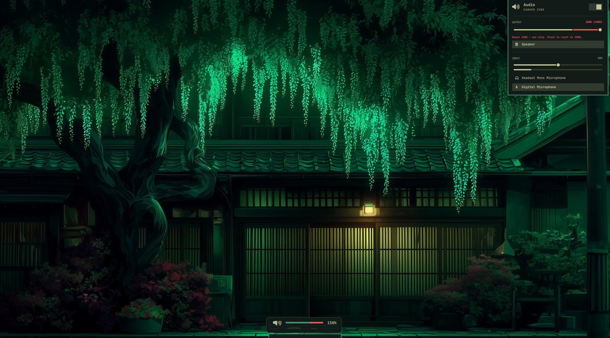

# Audio Boost

A bar widget and matching on-screen display for Omarchy that allow output
volume above 100%, with a configurable ceiling (150% by default), a two-tone
slider/OSD bar, and per-app boost.



## What it does

- Output and per-app sliders go to a configurable ceiling (100–200%, default
  **150%**).
- Up to 100% uses the theme accent; above 100% uses a configurable colour
  (default **`#ff5555`**), with a notch at the 100% boundary.
- The OSD uses the same two-tone bar. Brightness and media OSDs keep their
  normal single-colour look.
- The bar shows the current percentage and turns the boost colour above 100%.
- The panel shows `150% (+50%)`, a boost warning, and a click-to-reset row.
- `b` toggles boost, `0` resets to 100%; middle-clicking the bar icon also
  toggles boost.
- Optional media-key helper so the hardware VOL± keys can boost too.

## Install

```sh
omarchy plugin add https://github.com/kingokeke/omarchy-audio-boost.git --enable
omarchy plugin disable omarchy.audio
omarchy plugin disable omarchy.osd   # usually automatic via clonedFrom
omarchy bar move io.github.kingokeke.audio-boost --after omarchy.network
```

The plugin replaces the stock audio widget. The OSD clone disables the stock
`omarchy.osd` automatically; the explicit disable above is a safety step.

### Optional: media keys above 100%

The panel and per-app sliders work immediately. To make the hardware VOL± keys
use the boost ceiling too, copy the bundled helper and add four Hyprland binds:

```sh
mkdir -p ~/.local/bin
cp ~/.config/omarchy/plugins/io.github.kingokeke.audio-boost/bin/omarchy-volume-boost ~/.local/bin/
chmod +x ~/.local/bin/omarchy-volume-boost
```

Add to `~/.config/hypr/bindings.lua`:

```lua
hl.unbind("XF86AudioRaiseVolume")
hl.unbind("XF86AudioLowerVolume")
hl.unbind("ALT + XF86AudioRaiseVolume")
hl.unbind("ALT + XF86AudioLowerVolume")
o.bind("XF86AudioRaiseVolume", "Volume up", "~/.local/bin/omarchy-volume-boost raise", { locked = true, repeating = true })
o.bind("XF86AudioLowerVolume", "Volume down", "~/.local/bin/omarchy-volume-boost lower", { locked = true, repeating = true })
o.bind("ALT + XF86AudioRaiseVolume", "Volume up precise", "~/.local/bin/omarchy-volume-boost +1", { locked = true, repeating = true })
o.bind("ALT + XF86AudioLowerVolume", "Volume down precise", "~/.local/bin/omarchy-volume-boost -1", { locked = true, repeating = true })
```

Then run `hyprctl reload`. If you skip this, the stock keys still work and stop
at 100%.

## Settings

Settings live on the widget's entry in `~/.config/omarchy/shell.json`:

| Key | Type | Default | Meaning |
|---|---|---|---|
| `maxVolume` | integer 100–200 | `150` | Ceiling for the output/per-app sliders, keys, and OSD scale |
| `step` | integer 1–10 | `5` | Raise/lower step for keys and wheel (Alt is always 1%) |
| `showPercent` | boolean | `true` | Show the percentage next to the bar icon |
| `warnOnBoost` | boolean | `true` | Show the panel warning and first-cross notification |
| `boostEnabled` | boolean | `true` | Master switch; `false` hard-caps everything at 100% |
| `overdriveColor` | `#RRGGBB` | `#ff5555` | Colour above 100% in the OSD and panel; invalid values fall back to red |

Set them with:

```sh
omarchy bar set io.github.kingokeke.audio-boost maxVolume 150 --json
omarchy bar set io.github.kingokeke.audio-boost step 5 --json
omarchy bar set io.github.kingokeke.audio-boost showPercent true --json
omarchy bar set io.github.kingokeke.audio-boost warnOnBoost true --json
omarchy bar set io.github.kingokeke.audio-boost boostEnabled true --json
omarchy bar set io.github.kingokeke.audio-boost overdriveColor '#ff5555'
```

## Controls

- **Bar icon**: click opens the panel, right-click mutes, middle-click toggles
  boost (100% ↔ last boost / max), wheel adjusts volume.
- **Panel keys**: `h`/`l` adjust, `j`/`k` move, `m` mute, `b` toggle boost,
  `0` reset to 100%, Enter/Space activate, Tab switch sections, Esc close.
- **Warning row**: click it to reset to 100%.
- **Per-app streams**: sliders also use `maxVolume` and show the boost colour.

## OSD

The volume OSD receives `value`, `max`, `progressText`, `overdriveColor`, and
`overdriveFrom` (100). It paints 0–100 in the theme accent, 100–max in
`overdriveColor`, and draws a notch at 100. Payloads without those fields keep
the stock single-colour OSD.

## Safety

Above 100% is digital gain: it can clip or distort, and it does not make a weak
speaker produce more acoustic headroom. The plugin intentionally leaves
microphone/input volume capped at 100% and does not add a DSP limiter.

## Requirements

- Omarchy Quattro with the Quickshell bar
- PipeWire or PulseAudio utilities (`pactl`)
- `jq` and `omarchy-notification-send` for the optional key helper

These ship with Omarchy; no extra packages are required.

## Update and remove

```sh
omarchy plugin update io.github.kingokeke.audio-boost
omarchy plugin remove io.github.kingokeke.audio-boost
```

After removal, re-enable the stock widgets and remove the optional helper and
keybindings:

```sh
omarchy plugin enable omarchy.audio
omarchy plugin enable omarchy.osd
rm -f ~/.local/bin/omarchy-volume-boost
```

Then remove the four bindings from `~/.config/hypr/bindings.lua` and run
`hyprctl reload`.

## License

MIT. The audio panel and OSD are derived from Omarchy's built-in Audio and
On-screen display plugins, which are Copyright (c) David Heinemeier Hansson
and licensed under the MIT License. See [LICENSE](LICENSE).
